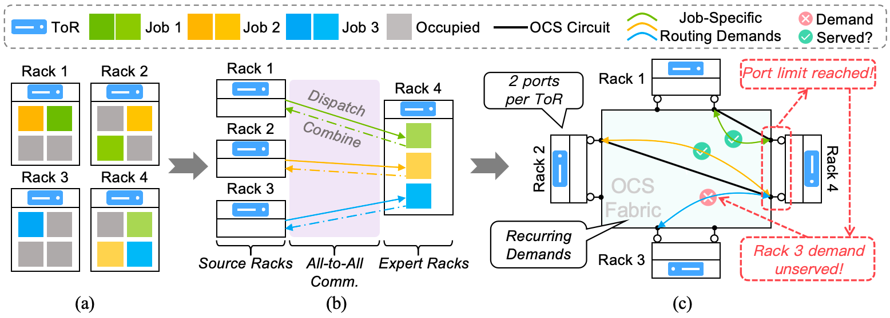
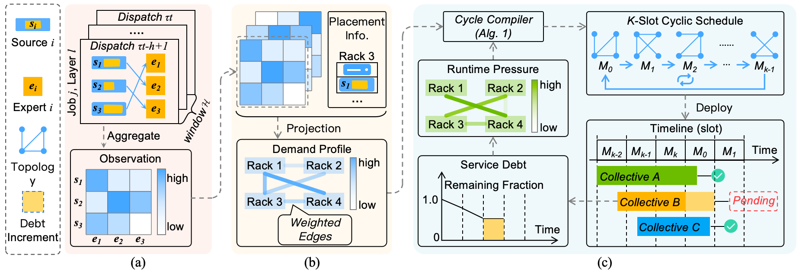

# drawing-cycmoe-yhd

CycMoE diagrams illustrating MoE communication over optical circuit switching (OCS) networks and cyclic scheduling.

[Download the editable PowerPoint](drawing-cycmoe-yhd.pptx)

## MoE Communication and OCS Constraints

## Cyclic Scheduling Overview

